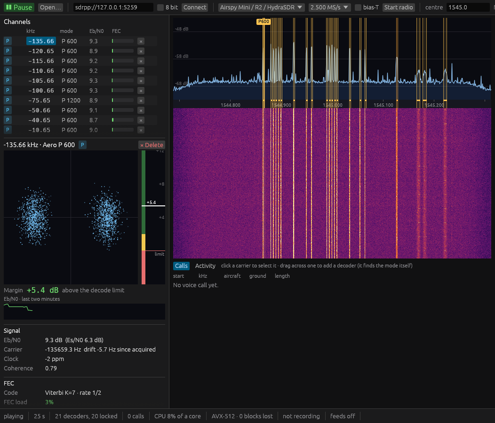
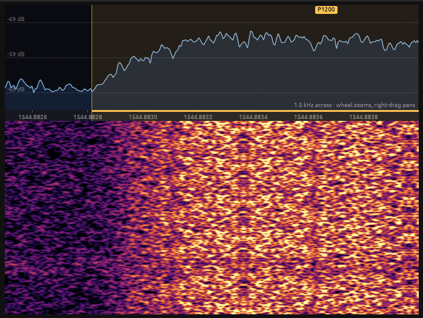
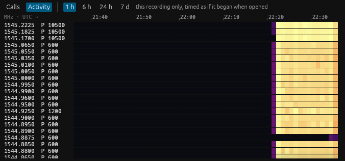

<!-- made by CasualArclamp -->
# DecAero

[](https://github.com/CasualArclamp/DecAero/releases/latest) [](https://github.com/CasualArclamp/DecAero/releases)

If you've found this worth your time, please consider [donating via PayPal](https://www.paypal.me/Arclamp).

A receiver for Inmarsat Classic Aero, the satellite link airliners use for
ACARS messages, position reports and cockpit voice. It decodes every carrier
in the band at once, follows voice calls as they are set up, and shows for
each carrier how well it is being received. Windows, one portable exe,
written in Rust. Receive only.



## What it does

**Decoding**
- P channels (ground to aircraft) at 600, 1200 and 10500 bit/s, with ACARS
  messages put back together from their signal units.
- R and T channel bursts (aircraft to ground), with ADS-C position reports
  read out of the ACARS they carry.
- C channel voice at 8400 bit/s, decoded to sound.
- The older C channel at 21000 bit/s, with its 9.6 kbit/s speech (British
  Telecom's multipulse LPC, from its definition in ICAO Annex 10), decoded
  to sound. Fax and data calls are named from the signalling and their
  frames saved, but not decoded: their layout is not public.
- A scan of the whole band finds the carriers and starts a decoder on each;
  you can also drag across a carrier to add one, and it names the mode itself.
- A decoder that loses its carrier finds it again on its own.
- The L-band correction carriers between the Aero channels (BPSK, 2438, 1219
  and 1200 symbols/s) are found too. Their payload is encrypted, so only what
  is in the clear is shown: lock, the frame's ID and header bits, signal and
  FEC figures.

**Voice**
- Voice follow: when a ground station assigns a voice channel, a decoder is
  started there and you hear the call. After turning it on, drag across
  the band to keep it to that part. A call's decoder goes when the call ends.
- Every call is saved as a small Ogg Opus file (about 5 MB an hour), named by
  date, time, frequency and aircraft, with a line in `calls.csv`.
- Call progress is read: who rang whom, the call's priority (distress,
  urgent, general) and how far it has got (status, connect, result, release).

**How well it is receiving**
- For each decoder: constellation, margin above the decode limit, Eb/N0,
  carrier offset and drift, clock error, FEC load, pre-FEC bit error rate,
  unique word errors, CRC and frame counts.
- Built for weak signals: the margin bar shows how close each carrier is to
  failing.

**The band**



- Spectrum and waterfall at 60 rows a second, drawn pixel for pixel.
- Big tuning digits for the centre frequency: scroll or click a digit to
  step it, right-click to zero it and those after it. On a live input,
  dragging the band with the middle button tunes the radio, and the
  waterfall's history moves along with it.
- **● I/Q** records the part of the band on screen as an I/Q WAV, to keep a
  signal for later.
- The wheel zooms about the cursor and right-drag pans. As you zoom in the
  FFT gets finer, down to 1 Hz bins, and what is already on screen stays.

**Aircraft**
- Registration, type and operator from a database fetched when you ask,
  with the country from the address and a mark for military aircraft.
- A list of aircraft seen, all, United States only, or military only.

**Activity**



- A heat map of which frequencies were in use and when, over the last hour,
  6 hours, day or week. A live input's history is kept between runs.

**Feeds out**
- ACARS as JSON over UDP in JAERO's layout, to any number of collectors.
- ADS-C positions as SBS (BaseStation) lines over TCP, for a map.

**Inputs**
- A recording (WAV, I/Q or a receiver's audio output).
- An SDR++ server, tuned from here, with the server's own controls for its
  radio (sample rate, gain, bias-T) shown under the top bar. Or plain I/Q
  over TCP or UDP.
- A radio directly: HackRF, Airspy / HydraSDR, ADALM-PLUTO, SDRplay, Fobos,
  RTL-SDR or USRP, with gain controls and bias-T (off unless you turn it on).

Settings are kept between runs in `%APPDATA%\DecAero\prefs.txt`.

## Where it stands

Decoding is checked on off-air recordings and on JAERO's samples. A real
SDR++ server works for samples, tuning and its controls. Not yet tried on
air: the direct radio inputs, C band, and a voice call strong enough to
listen to. Call tones (ringback) are silent: see
[docs/DESIGN.md](docs/DESIGN.md), which has the design and what is left.

## Building

```bash
cargo run --release -p decaero-gui -- RECORDING.wav --center 1545.0
```

CMake must be on the PATH (libopus is built from source). The portable exe:
`powershell -ExecutionPolicy Bypass -File scripts/build-portable.ps1`.

## Android

The same program with a layout for fingers, for a phone held sideways:

```
powershell -ExecutionPolicy Bypass -File scripts/build-android.ps1
```

makes `exe/DecAero-<version>.apk` (the script's first lines say what it needs).
Copy it to the phone and open it to install; Android asks once to allow
installing from that source.

- The band has the screen; the buttons down the left open one panel beside it.
  On the band two fingers pinch to zoom; one finger moves the view, draws a
  new decoder or tunes, as the buttons at its foot say.
- **Input** starts a radio on the USB socket (an RTL-SDR, V3 and V4 among
  them, or an Airspy / HydraSDR, on an OTG lead), connects to an SDR++ server
  or a plain I/Q stream, or opens a recording. Android asks before the app may
  use a radio. Receive only; the bias tee is off unless ticked.
- Settings, the aircraft database, call recordings and I/Q recordings are in
  `Android/data/com.casualarclamp.decaero/files` on the phone's storage.
- It runs while it is on screen (the screen is kept on), not in the background.

Tried in the Android emulator on a recording. **The USB radios have not been
tried on a real phone or a real radio yet.**

`decaero-gui --touch --size 832x384` shows the same layout on a desktop.

## Credits and licence

Built on the work of JAERO, libaeroambe and mbelib: see [NOTICE](NOTICE),
which also carries the voice codec's patent notice.

Licence: GPL-3.0-or-later.
